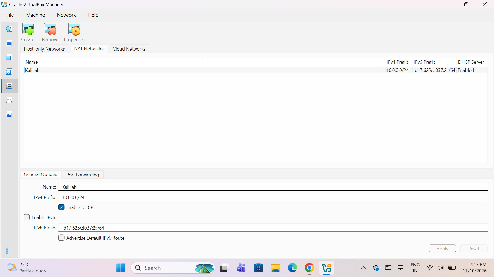
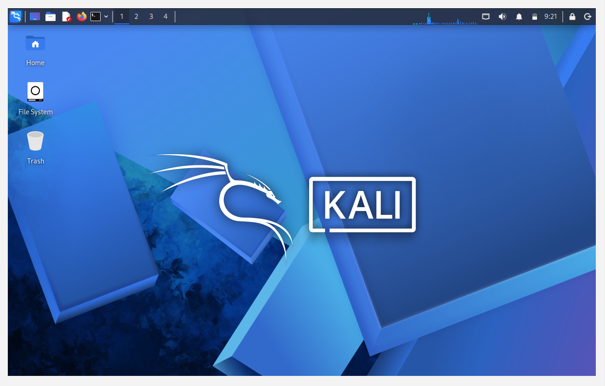
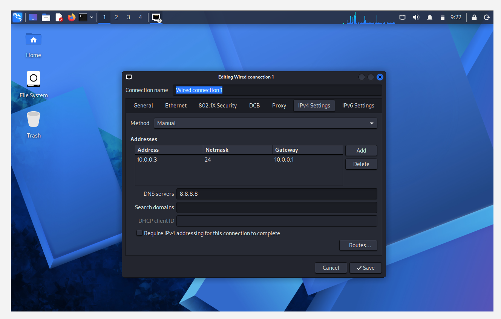
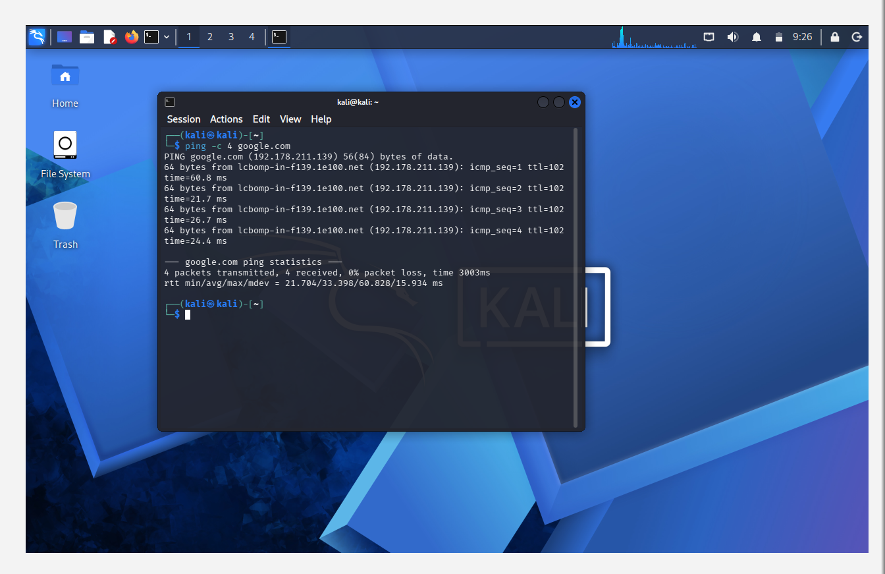

# 🔐 Cybersecurity Lab Environment Setup

**Building an isolated virtual lab for penetration testing and ethical hacking practice**


---

## 📌 Project Overview

This project sets up a **virtual cybersecurity and penetration-testing laboratory** using VirtualBox and Kali Linux.

The lab gives a controlled environment where cybersecurity tools, network scanning, reconnaissance and other security-testing activities can be practised safely and repeatedly.

The lab runs on a private virtual network (NAT Network), so more machines can be added later and used as targets for authorized security testing.

---

## 🎯 Objectives

- Install and configure VirtualBox.
- Install/import Kali Linux as a virtual machine.
- Create a private **NAT Network** for the cybersecurity lab.
- Assign a fixed IP address to the Kali VM.
- Verify network connectivity and DNS resolution.
- Document the complete setup process.
- Prepare the environment for future cybersecurity projects.

---

## 🛡️ Purpose of the Lab

The lab provides an isolated environment for cybersecurity learning and authorized security testing, such as:

- Network reconnaissance
- Port scanning
- Vulnerability assessment
- Packet analysis
- Web security testing
- Security-tool experimentation

⚠️ **Important:** This lab must only be used on systems that you own or have explicit permission to test. Do not use the lab or its tools against unauthorized systems.

---

## ⚙️ Lab Configuration

| Component | Configuration |
| --- | --- |
| Host OS | Windows |
| Hypervisor | Oracle VirtualBox |
| Security OS | Kali Linux (virtual machine) |
| Virtual Network | NAT Network – `KaliLab` |
| Network Address | 10.0.0.0/24 |
| DHCP Server | Enabled |
| IPv6 | Disabled |
| Kali IP Address | 10.0.0.3/24 |
| Default Gateway | 10.0.0.1 |
| DNS Server | 8.8.8.8 |

---

# 🪜 Lab Setup Procedure

## Step 1. Create the NAT Network in VirtualBox

A dedicated NAT Network was created in the VirtualBox Network Manager.

```
Name:        KaliLab
IPv4 Prefix: 10.0.0.0/24
DHCP:        Enabled
IPv6:        Disabled
```

A **NAT Network** was chosen because multiple virtual machines on the same NAT Network can communicate with each other and also have outbound Internet access. This allows future attacker and target VMs to work together in the lab.



---

## Step 2. Install / Import Kali Linux

Kali Linux was imported into VirtualBox as a virtual machine, and its network adapter was attached to the `KaliLab` NAT Network.

The Kali VM started successfully and the desktop loaded.



---

## Step 3. Configure a Fixed IP Address on Kali

In Kali Linux, the wired connection was edited and the IPv4 method was changed to **Manual**.

```
Method:     Manual
IP Address: 10.0.0.3
Netmask:    24 (255.255.255.0)
Gateway:    10.0.0.1
DNS:        8.8.8.8
```

A fixed IP address makes the lab easier to document and lets other machines refer to Kali reliably in future exercises.



---

## Step 4. Verify Internet Connectivity

Connectivity and DNS resolution were tested from the Kali terminal:

```
ping -c 4 google.com
```



---

# 🔎 Lab Verification

| Test | Command | Result |
| --- | --- | --- |
| Internet connectivity and DNS | `ping -c 4 google.com` | google.com resolved to 192.178.211.139 |
| Packets | – | 4 transmitted, 4 received, **0% packet loss** |
| Response time | – | min/avg/max = 21.704 / 33.398 / 60.828 ms |

The successful replies show that the Kali VM has a working IP configuration, can reach the Internet through the NAT Network, and can resolve domain names using the configured DNS server.

---

# 💡 What I Learned

1. **NAT Network:** how it lets several VMs share one private network while still reaching the Internet.
2. **Virtual machine networking:** how VirtualBox network adapters connect VMs to a virtual network.
3. **Static IP configuration:** how to set the IP address, netmask, gateway and DNS on Kali Linux.
4. **Connectivity testing:** how to use `ping` to confirm network and DNS are working.
5. **Documentation:** why recording configuration and screenshots is an important part of a professional cybersecurity project.

---

# 🔐 Security & Ethical Use

This laboratory is intended strictly for educational purposes. Only test systems that you own or have written permission to test.

---

# 🔗 Tools & Resources

- **VirtualBox:** https://www.virtualbox.org/wiki/Downloads
- **Kali Linux:** https://www.kali.org/get-kali/

---

# 👤 Author

**Asmita Ashok Devkar**
Cybersecurity Intern – Networkwalks
**Program/Batch:** B084-Networkwalks

---

## 📌 Project Information

**Program Name:** Cybersecurity at Networkwalks | **Week:** 01 | **Project:** Cybersecurity & Pentesting Lab Setup | **Repository:** GitHub
